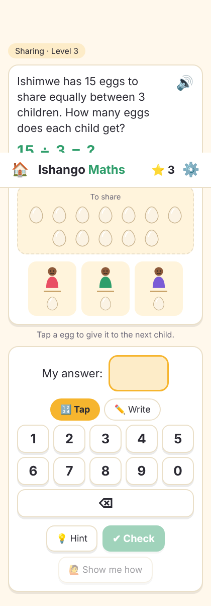

# Ishango Maths

A friendly maths game for young children who are just starting school. Children learn
**counting, adding, taking away, groups (multiplication) and sharing (division)** with
everyday things: pens, potatoes, beans, small stones, mangoes and eggs.



## What children do

- **Look and count.** Every problem is drawn with real objects. Children tap each object
  as they count it, and in sharing problems they tap beans or stones to hand them out
  to the children one at a time.
- **Answer in their own way.** Tap the number on a big keypad, or write it with a finger
  on the writing pad.
- **Take their time.** Nothing is revealed until the child presses **Check**. There is no
  countdown. **Show me how** stays locked during a thinking time (20 seconds by default,
  adjustable by a grown-up), with a gently filling bar.
- **Learn from mistakes.** A wrong answer gets a "not yet" and a hint, and the child tries
  again. After three tries, the app counts it through with them, numbering the
  objects one by one.
- **Listen.** Questions and feedback are read aloud for children who cannot read yet.

## How it adapts

Each topic has 5 levels (level 1 counting goes up to 5; level 5 adding goes up to 30).

- Three answers in a row that are right first time, without hints, move up a level.
- Two problems the child could not solve, with no confident answer in between, move down a level.
- Problems the child found hard come back later, with the same numbers and new objects.
- Topics open step by step: Counting → Adding → Taking away and Groups → Sharing.

Progress is saved on the device, with a separate profile for each child.

## The AI tutor (optional)

With a Claude API key, the app also:

- writes **personal feedback and hints** that react to the child's actual answer
  (for example, noticing they added when they should have taken away),
- **reads the child's handwritten number** from the writing pad,
- writes a short **progress note for parents and teachers**, with an activity to try at home.

The game itself always decides whether an answer is right. The AI only chooses the words, and
a hint that would give the answer away is replaced by the built-in hint. Without a key, or if the
AI is slow, the app falls back to built-in messages, so it works fully offline.

## Run it

Needs Node.js 18 or newer.

```bash
cd kids-math
npm install
npm start                                 # http://localhost:3000, built-in feedback
ANTHROPIC_API_KEY=sk-ant-... npm start    # with the AI tutor
```

The API key stays on the server and is never sent to the browser. Set `PORT` to change the port,
or `KIDS_MATH_AI=off` to switch the AI off.

```bash
npm test     # tests for the problem generator and the levelling rules
```

## Files

| Path | What it is |
|---|---|
| `public/js/engine.js` | Problem generator, answer checking, adaptive levels (no DOM, unit tested) |
| `public/js/app.js` | Screens, pictures, keypad, writing pad, thinking time, voice |
| `public/js/objects.js` | Drawings of the everyday objects |
| `server.js` | Serves the app and the AI tutor endpoints (`/api/feedback`, `/api/read-digits`, `/api/report`) |
| `test/engine.test.js` | Unit tests |
